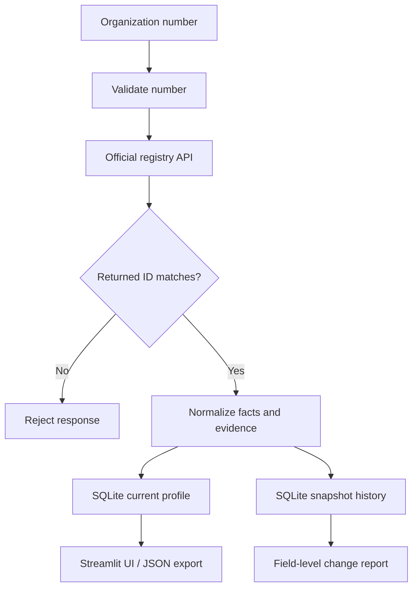

# Architecture

1. `CompanyAgent` validates a Norwegian organization number and requests the matching official entity record.
2. An identity guard rejects any response whose returned organization number differs from the requested number.
3. `normalize_company` maps source fields to a stable schema and attaches source URL and retrieval time as evidence metadata.
4. `database.py` stores the latest profile plus a history row for every observation. Change detection ignores metadata-only changes.
5. `collector.py` pages through the official registry search endpoint to seed a real profile dataset.
6. `app.py` provides lookup, profile collection, saved-profile browsing, evidence links and JSON export.
7. `main.py` provides repeatable command-line operations for lookup, collection and export.

